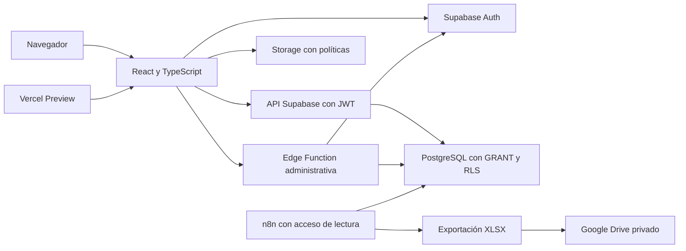

# Arquitectura inicial — PROPUESTA técnica

Fecha: 05/11/2026. Referencias: EDT 1.2.1.1–1.2.2.4. El stack está respaldado por Confluence; la organización interna y los contratos siguientes son propuestas locales. No hay arquitectura desplegada.

## Responsabilidades

| Capa | Responsabilidad y límite |
| --- | --- |
| Presentación | Renderizar estados, validar formularios para UX y recibir interacciones. No consultar directamente la base |
| Servicios de cada funcionalidad | Llamadas Supabase, validación de respuestas externas y traducción de errores |
| Dominio | Tipos y reglas documentadas; sin fórmulas financieras supuestas |
| Auth | Identidad y sesión; una identidad no implica autorización contractual |
| PostgreSQL | Integridad, autorización por filas y operaciones atómicas de pagos |
| Edge Function | Validar JWT y permiso administrativo vigente antes de usar secretos para crear cuentas |
| Storage | Autorizar archivos según vínculo y publicación; comprobantes privados |
| n8n | Exportar tablas autorizadas con credenciales de lectura; no ejecutar negocio |

Estructura incremental prevista: src/app, src/features/<funcionalidad>, src/integrations/supabase y src/shared; supabase/migrations y tests; automation/n8n al implementar la exportación. Crear solo directorios con contenido útil.

## Flujos y contratos propuestos

1. Catálogo: solicitar únicamente propiedades publicadas mediante consulta autorizada por RLS. DTO público explícito: id, título, operación venta/alquiler, descripción y referencias a fotos autorizadas. Nunca incluir importes ni datos contractuales. Detalle por ID aplica el mismo filtro en servidor. Ocultar en React no protege registros.
2. Sesión: Auth autentica; el servicio obtiene autorización vigente desde datos protegidos. Cuenta sin habilitación o sin vínculo no recibe información contractual. Los compradores no pueden editar roles ni relaciones. Las rutas privadas sirven a la navegación; RLS controla cada petición.
3. Alta: Edge Function valida identidad y rol desde una fuente que el comprador no pueda modificar. Crear cuenta y vincular son pasos susceptibles de fallo parcial entre Auth y PostgreSQL: una cuenta incompleta permanece sin habilitación contractual. Usar idempotencia y reconciliación antes de habilitarla; no afirmar una transacción distribuida inexistente.
4. Pago: función PostgreSQL restringida registra operación y evento atómicamente. Corrección exige motivo no vacío, actor derivado de identidad del servidor y versión esperada. Bloquear el registro para serializar cambios concurrentes. Conservar original; no permitir UPDATE/DELETE de eventos al cliente. Repetir una solicitud no debe duplicar pagos.
5. Comprobantes: el servidor autoriza el vínculo antes de generar acceso temporal; no basta conocer una ruta. Visor dentro del portal sin botón específico de descarga. Un navegador que muestra un archivo puede guardarlo. Vigencia de URLs deberá justificarse y probarse.
6. Fotos: evitar bucket público de acceso irrestricto, porque despublicar debe retirar también acceso a recursos. Propuesta: bucket privado y lecturas autenticadas/autorizadas con políticas vinculadas a publicación. Documentar la ventana de vigencia de cualquier URL firmada o caché.
7. Exportación: consulta con lista explícita de columnas aprobadas, XLSX, carga privada y verificación de resultado. No exportar Auth, tokens ni credenciales. El XLSX no es respaldo restaurable integral.

Los servicios devolverán éxito tipado o error explícito (sin sesión, prohibido, validación, conflicto, no encontrado, indisponible). La UI distinguirá carga, vacío, error y éxito y evitará doble envío. No revelar existencia de correos en recuperación.

## Modelo conceptual y propuesta relacional

| Entidad | Responsabilidad | Relaciones pendientes |
| --- | --- | --- |
| Cliente | Identidad de negocio ficticia | Cantidad de cuentas por cliente |
| Cuenta de acceso | Identidad Auth y habilitación | Roles exactos y cardinalidad cuenta–cliente |
| Propiedad | Publicación comercial | Relación con lote, si corresponde |
| Fotografía | Ruta y metadatos del recurso | Orden y propiedad asociada |
| Lote | Identidad del bien financiado | Cantidad de lotes por contrato |
| Contrato | Identidad e historia contractual | Titulares, cuentas autorizadas y lotes |
| Plan | Condiciones registradas | Versionado y cantidad de planes por contrato |
| Cuota | Vencimiento e importe registrados | Reglas de composición y estados |
| Pago | Operación manual original | Imputación a una o varias cuotas y pagos parciales |
| Comprobante | Referencia privada y metadatos | Cantidad de comprobantes por pago |
| Evento de pago | Operación, anterior/posterior, motivo, actor, instante y referencia | Vinculado al pago original |

Relacional preliminar: properties y property_photos pueden ser el primer incremento independiente. Las tablas contractuales se diseñarán después de resolver o documentar formalmente alternativas de cardinalidad; no se añade un UNIQUE que asuma un contrato por cuenta. No existen migraciones todavía.

Propuestas de tipos: UUID para identidad; timestamptz para eventos (almacenar instantes UTC, mostrar zona local); date para vencimientos civiles; numeric para dinero y código de moneda explícito. Precisión, escala y monedas admitidas deben validarse antes del esquema financiero. Claves foráneas con borrado restringido para historia. No almacenar un saldo derivado sin regla validada.

## Decisiones y alternativas

- Usar BaaS Supabase, sin backend tradicional adicional: coincide con stack y reduce superficies de mantenimiento.
- Operaciones privilegiadas solo en servidor: protege secretos y evita que el navegador cree compradores arbitrariamente.
- Sin localStorage como sustituto de persistencia o autenticación. Un modo simulado futuro deberá identificarse expresamente.
- Sin framework visual ni gestor global por anticipado. Primero localizar guía Figma; cualquier alternativa local será PROPUESTA.
- No instalar todavía dependencias para una interfaz que podría duplicar el repositorio canónico del equipo. Identificarlo permite reutilizar trabajo; la implementación local del catálogo sigue siendo posible si no hay código disponible.

## Verificación requerida

Revisar cada flujo contra RF-01–08; ejecutar RLS positiva y negativa con sesiones reales, SQL de integridad, atomicidad de pagos y aislamiento de archivos. El diagrama y los contratos son documentación de diseño, no evidencia de ejecución.
